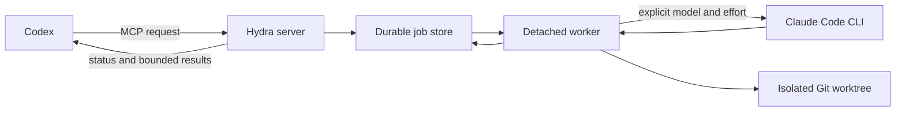

# Hydra

Run bounded Claude Code jobs from Codex without handing over your repository or your release process.

[](https://github.com/azixxxxx/Hydra/actions/workflows/ci.yml)
[](https://github.com/azixxxxx/Hydra/releases)
[](./LICENSE)

Hydra is a local Codex plugin that sends a specific engineering task to the Claude Code CLI already signed in on your Mac. Jobs run in the background. Write access stays inside isolated Git worktrees. Codex remains responsible for checking the result and deciding what reaches your branch.

Hydra uses your Claude.ai Pro or Max subscription. It rejects API credentials, provider gateways, and automatic model fallback.

## Why Hydra exists

A fresh agent pays for context again. Three broad mid-tier sessions can consume more input and cache tokens than one focused Opus session that settles the question.

Hydra makes that cost visible and starts with one lead by default. It opens another session only for a separate scope, an unresolved question, or an independent judgment that the plan names in advance. Each session receives a bounded evidence capsule and a small role-specific delta instead of the host conversation.

## What it provides

| Concern | Hydra's rule |
|---|---|
| Authentication | Use the installed Claude Code CLI and an existing Claude.ai Pro or Max login. |
| Model choice | Request Sonnet, Opus, Fable, or a full Claude model ID explicitly. Never fall back. |
| Fan-out | Start with one lead. Permit at most three fresh sessions and one Fable session per plan. |
| Writes | Run test and execute jobs in dedicated detached Git worktrees. |
| Network | Use a strict empty allowlist for sandboxed write jobs. |
| Persistence | Keep bounded, sanitized events and immutable terminal results on disk. |
| Cancellation | Signal only identity-matching process groups, then escalate from `SIGTERM` to `SIGKILL`. |
| Allowance | Pace manual usage snapshots; preserve quality floors and reject paid overflow. |

## Install

Hydra 1.0 supports macOS on Apple silicon. You need Node.js 20.9 or newer, Git, Codex, and Claude Code 2.1.228 or newer.

```bash
git clone https://github.com/azixxxxx/Hydra.git
cd Hydra
npm ci
npm run check

codex plugin marketplace add "$PWD"
codex plugin add hydra@hydra-local
```

Open a new Codex task after installation so it discovers the MCP server and bundled skills.

## First run

Start with preflight. It checks the local CLI version, Claude.ai authentication, provider routing, and the capabilities Hydra relies on.

> Run Hydra preflight for this repository.

Then ask for a bounded job:

> Ask Opus for an independent architecture review of the persistence layer. Limit the evidence capsule to the relevant files and return repository references for every finding.

Hydra exposes nine MCP tools for preflight, routing, starting jobs, status, paginated results, continuation, cancellation, outcome recording, and allowance snapshots. See the [plugin reference](./plugins/hydra/README.md) for request shapes and operating details.

## How it fits together



The server returns immediately after it creates a durable job and launches its worker. The worker survives an MCP restart, records sanitized evidence, and preserves useful worktrees for inspection. Hydra never commits, pushes, merges, deploys, or applies a patch to your main checkout.

## Allowance pacing

Hydra records manual snapshots from Claude Settings as integer basis points. It does not scrape the account page, call private usage endpoints, or pretend that local token counts equal a weekly quota percentage.

During most of the week, Hydra conserves optional work. Inside the final 24 hours, it can spend verified surplus more aggressively, but only when it has enough matching observations, the snapshot is fresh, the job is useful, and every applicable bucket still fits its reserve. Required model and effort never decrease to save allowance.

The account-level usage-credit switch remains a manual check. Keep usage credits disabled if paid overflow must be impossible. If Claude asks for credits, Hydra stops with `USAGE_CREDITS_REQUIRED` rather than switching models or billing paths.

## Security boundary

Hydra removes external setting sources, hooks, project MCP servers, automatic memory, WebFetch, and WebSearch from delegated jobs. Read permissions are scoped to the repository or worktree. Git setup disables hooks, filters, text conversion, and fsmonitor execution.

Sanitization is a backstop, not a reason to place secrets in prompts or repository output. Do not include credentials in tasks, roles, schemas, notes, fixtures, or issues. Report a credential leak, sandbox escape, routing bypass, or cancellation defect through a [private security advisory](https://github.com/azixxxxx/Hydra/security/advisories/new).

## Support

| Platform | Status |
|---|---|
| macOS arm64 | Maintained and release-tested |
| Linux | Code paths exist; community-owned and unverified |
| macOS x64 | Unverified |
| Windows | Unsupported |

Linux support can graduate when it has a maintainer and CI evidence for process identity, descendant cancellation, settings discovery, sandbox behavior, filesystem isolation, and subscription-only routing.

## Documentation

- [Plugin reference](./plugins/hydra/README.md)
- [Hydra 1.0 boundary](./docs/1.0-boundary.md)
- [Architecture decisions](./docs/adr)
- [Hydra 1.0 verification report](./docs/verification/2026-08-13-hydra-1.0.md)
- [Contributing](./CONTRIBUTING.md)
- [Security policy](./SECURITY.md)
- [Changelog](./CHANGELOG.md)

## Development

```bash
npm ci
npm test
npm run check
```

The default suite uses a mock Claude CLI and consumes no subscription allowance. Real Claude and isolation probes are opt-in and must stay disabled in public CI.

## License

[MIT](./LICENSE) © 2026 [azixxxxx](https://github.com/azixxxxx)
